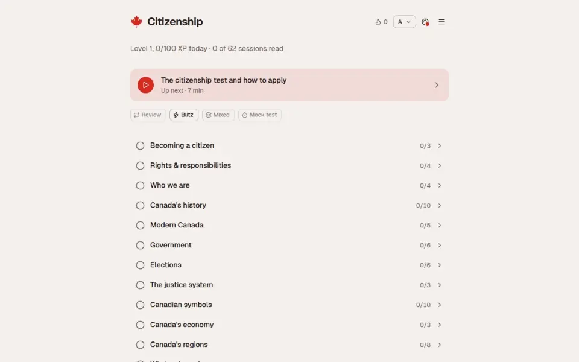

# Citizenship

A local-first, two-person study desk for the Canadian citizenship test.

**[Try it in your browser](https://citizenship.soleone.xyz)**, no account needed.



## Run it

```bash
pnpm install
vp dev
```

Then open the local URL shown in the terminal. Built with [kit](../kit) (Vite+, shadcn base-nova, the @soleone theme picker: press `T`).

## Addresses

Every screen is a URL, so the back button, a refresh and a bookmark all land where you were standing:

| Address                                                                                               | Screen                                                                                                            |
| ----------------------------------------------------------------------------------------------------- | ----------------------------------------------------------------------------------------------------------------- |
| `/`                                                                                                   | Home: where you stand, the next step, review, blitz, mixed and mock, and every chapter with its sessions and test |
| `/study/<session>`                                                                                    | One session, bite by bite with its quick checks. `?bite=3` opens the third bite                                   |
| `/study/<session>/complete`                                                                           | The session score and what comes back tomorrow                                                                    |
| `/tests/session/<session>`, `/tests/module/<chapter>`, `/tests/mixed`, `/tests/mock`, `/tests/review` | A run of that test. `/q/7` is the seventh question, `/complete` is the result                                     |
| `/blitz`                                                                                              | 60-second speed round, or a pass-the-device duel with `?as=both`                                                  |
| `/together`, `/application`                                                                           | Teach-backs and the guide's own questions; eligibility and application steps                                      |

Add `?as=partner` to any of them to work as the other learner.

Two things follow. A refresh in the middle of a test resumes it: the questions that run drew, its score and the mock exam's remaining time are kept in this browser, and the mock clock counts against the wall clock while the tab is closed, because the real one does not pause. And a result only appears at `/complete` for a run that was actually handed in, so typing that address starts a fresh test instead of showing a mark.

`vp dev` and `vp preview` answer these paths directly. A static host needs its usual single-page rewrite to `index.html`.

## What is included

- **Coverage:** 11 modules, one per chapter of _Discover Canada_, split into 60-odd sessions of a few minutes each and about 400 practice questions.
- **Home:** one line of where you stand, the next step, the practice modes, and every chapter as a quiet row that opens to its sessions and chapter test. "Who's who today" holds today's officeholders and your own province, premier and MP.
- **Sessions:** a few short bites, each followed straight away by its quick checks. Question, answers and feedback sit in one column; the source quote is one click away. Answering every check is the session test.
- **Rewards:** XP per right answer with a small combo bonus, a daily goal of 100 XP, a day streak, and levels. Sound (mutable) and confetti mark the moments that matter.
- **Blitz:** 60 seconds, as many as you can, from sessions already read. On the shared desk it is a duel.
- **Tests:** a test per chapter once it is read, a mixed check, and a mock test that is timed, forward-only and marked at the end, like the real one: 20 questions, 45 minutes, 15 to pass.
- **Memory queue:** every answer is graded into a Leitner box. A miss gets one more look at the end of the same test, then comes back at 1, 2, 4, 7, 16 and 35 day gaps.
- **Together:** teach-backs from sessions you have read, and the guide's own 28 open questions to answer out loud.
- **Application:** the physical-presence arithmetic per learner, the application steps (details on click), and the test-day checklist.

## Sync between devices

Without setup, progress stays in the browser. With a household, every phone and laptop that opened the household link shares one copy, so A and B see each other's progress anywhere:

- `worker/` is a Cloudflare Worker with one Durable Object holding the household's state. Every request needs the household key, and each write keeps the version it replaced (the last 30), so a bad sync can be rolled back.
- A device pulls when it opens or comes back into view, and pushes a moment after a change. When two devices both changed since they last agreed, the newer save wins.
- Application dates and the sound switch never leave the device. Settings has a backup download with everything, dates included, and a restore.

```bash
pnpm sync:check                                                 # two simulated devices against the real Worker
pnpm sync:deploy                                                # deploy the Worker

pnpm dlx wrangler@4 secret put HOUSEHOLD_KEY -c worker/wrangler.jsonc
```

Every push to `main` deploys the app to https://citizenship.soleone.xyz through Vercel's Git integration. The Worker's address is `SYNC_URL` in `src/sync.ts`; the key is in `$DATA/secrets/citizenship/`. Join a device by opening `<app>/#join=<household key>` once; Settings copies that link for the next device.

## Audio

`pnpm audio:generate` speaks every session (bites, takeaways, questions and answers) with the local Phonon 31M voice Miles, in study order, into `$DATA/apps/citizenship/audio/phonon-miles/`. Each clip is named by a hash of its text, so an edited line gets a new clip. Ctrl-C stops it cleanly and a rerun continues where it stopped. `pnpm audio:generate:breeze` does the same with Breeze TTS 2's designed voice radio-man into `breeze-radio-man/`: better sound, about 28 h. Each needs its env from the tts-scout skill (`$DATA/apps/tts-scout/envs/<model>`) and ffmpeg.

**Voice mode** (the headphones button in a study session) reads each bite and quick check aloud and listens for an answer: Alpha, Bravo, Charlie or Delta (true or false on true/false questions), "repeat" and "next"; silence after a reading moves on. Speech is recognised in the page by Moonshine base (a one-time 63 MB download), not the browser's own recognizer, which switches Android into call mode and garbles playback for seconds afterwards. The screen stays awake while it is on.

`pnpm audio:upload` (or `pnpm audio:upload breeze`) copies the finished clips to the R2 bucket `citizenship-audio` behind the sync Worker, sending only the ones it doesn't have. Anyone can play a clip at `<SYNC_URL>/audio/<voice>/<clip id>.mp3`; uploading needs the household key.

## Where the content comes from

`data/corpus/` holds plain-text captures of every chapter of _Discover Canada_ plus the IRCC test and application pages. Every study bite and every question carries an `evidence` string that must appear verbatim in those files:

```bash
pnpm curriculum:check      # verify all evidence, ids, shapes and coverage
pnpm curriculum:logic      # gating, sampling, scoring and the Leitner rules
pnpm eligibility:check     # the date arithmetic, against IRCC's own sentences
pnpm curriculum:fetch      # re-capture the corpus from canada.ca
```

The check is the reason a claim in this app is worth something. Add a question that quotes something the guide never says and it fails, naming the sentence the guide actually uses. It also walks the guide's own section headings and fails if any section with real prose is not taught, so "full coverage" is a measured claim rather than a promise.

Facts the 2012 guide has since outgrown (the named Sovereign, the number of ridings, the age range for the test) keep the guide's answer and carry a visible caveat, because the guide still defines the test.

## Important accuracy boundary

The Government of Canada guide, _Discover Canada: The Rights and Responsibilities of Citizenship_, is the primary study source. The app links directly to Canada.ca and labels its own questions as unofficial practice. Requirements, fees, processing times and test procedures can change, so verify them against the current IRCC pages before applying or taking the test.

Citizenship is not IRCC, legal advice, an immigration representative, or the official citizenship test.

## Validation

```bash
pnpm verify   # vp check, curriculum, eligibility, route and sync checks, build
kit check     # vendored components match upstream, no dead code
```
